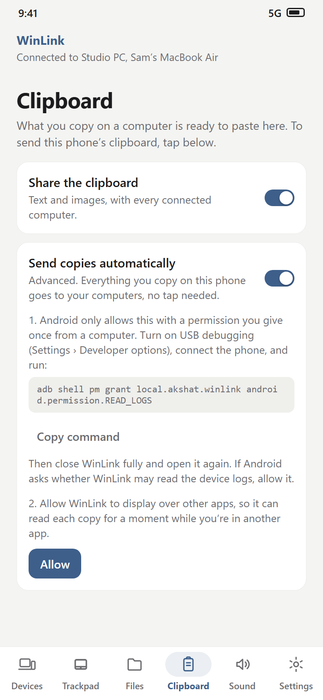
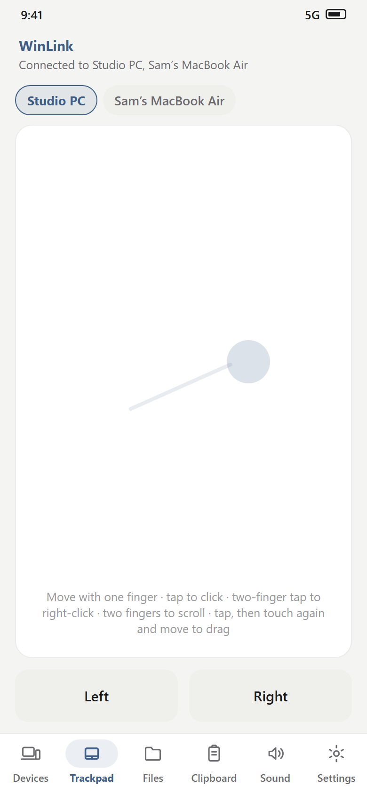
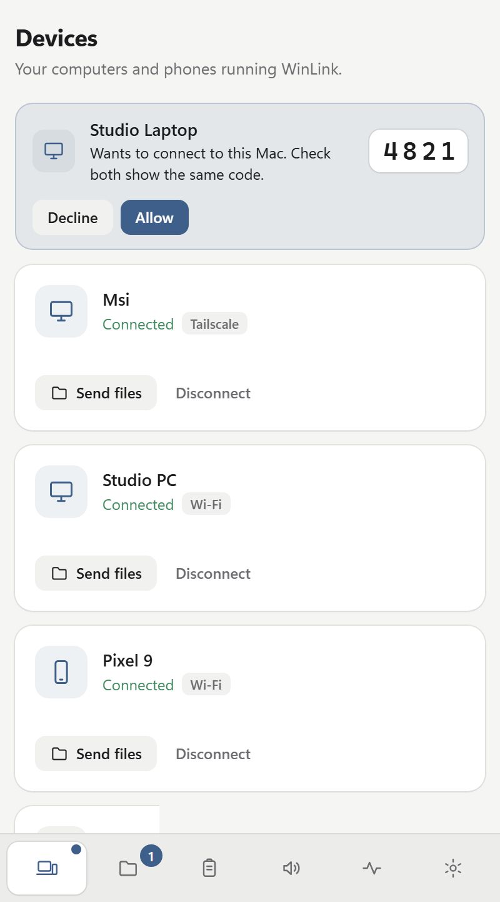
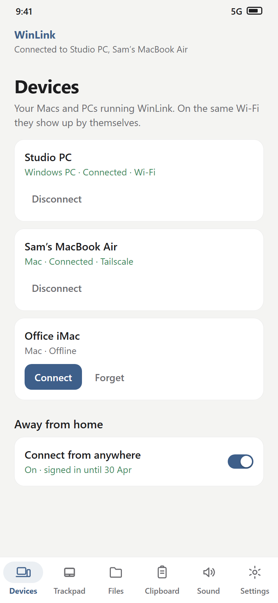
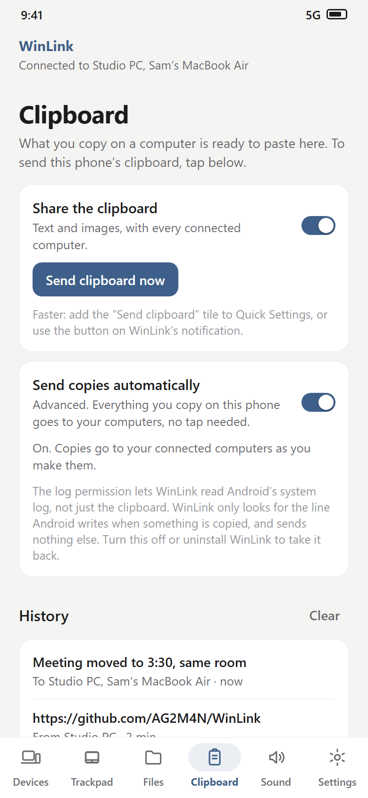

<p align="center">
  
</p>

<h1 align="center">WinLink</h1>

<p align="center">
  <b>Your Mac, Windows, Linux and Android devices, working as one.</b><br>
  One clipboard · files and folders · sound anywhere · one keyboard and mouse · your phone as a trackpad · at home or from anywhere
</p>

<p align="center">
  <a href="LICENSE"></a>
  
  
  
  
</p>

<p align="center">
  <picture>
    <source media="(prefers-color-scheme: dark)" srcset="docs/screenshots/devices-dark.png">
    
  </picture>
</p>

WinLink is a free app for **Mac, Windows, Linux and Android**. Install it on each device and pair them
once: from then on they find each other and stay connected by themselves. No accounts, no cloud, no IP
addresses to type. Everything goes directly between your own devices, encrypted.

## Highlights

- 📋 **One clipboard.** Copy text, pictures or files on any device, paste on any other.
- 📱 **Hands-free copying from Android.** What you copy on the phone reaches your computers with no tap.
- 🖱️ **Your phone as a trackpad** for any of your Macs and PCs.
- ⌨️ **One keyboard and mouse** across Mac, Windows and Linux: move the pointer off one screen onto the next.
- 📁 **Files and folders** in any direction, with resume if the connection drops.
- 🔊 **Sound anywhere:** play one device's sound on another.
- 🌍 **From anywhere:** at home on Wi‑Fi, or across the internet with built-in Tailscale.
- 🔒 **Private:** paired with a 4-digit code, encrypted end to end, no cloud.

## Download

Get the latest version from the **[Releases](../../releases/latest) page**.

| System | File | Install |
|---|---|---|
| **Mac** (macOS 13+) | `WinLink-mac-AppleSilicon.dmg` or `WinLink-mac-Intel.dmg` | Drag **WinLink** to Applications. First time: right-click → **Open** (macOS 15: *Privacy & Security* → **Open Anyway**). |
| **Windows** 10/11 | `WinLink-Setup.exe` | Run it. No administrator needed. |
| **Ubuntu, Debian, Mint** | `winlink_…_amd64.deb` (`_arm64.deb` for ARM) | `sudo apt install ./winlink_*.deb` |
| **Fedora** | `winlink-….x86_64.rpm` (`.aarch64.rpm` for ARM) | `sudo dnf install ./winlink-*.rpm` |
| **Other Linux** | the source code | `sh install_linux.sh` |
| **Android** 10+ | `WinLink.apk` | Open it on the phone. |

To update, install the new version over the old one: pairings and settings stay.

<details>
<summary><b>Notes for each system</b></summary>

- **Mac:** allow WinLink to find devices on your local network when asked. Keyboard and mouse sharing and
  the trackpad need WinLink under *System Settings → Privacy & Security → Accessibility*; sharing the
  Mac's sound needs *Screen & System Audio Recording*. WinLink shows a button for each.
- **Windows:** if Windows Firewall asks, allow **Private networks**. Works on Windows on ARM too.
- **Linux:** works with GNOME, KDE, Cinnamon, Xfce and others, on Wayland or X11. Log out and back in once
  after installing (for the phone trackpad). `winlink --check` shows what works and what to install. If
  apt ends with *"N: Download is performed unsandboxed as root…"*, that's only a note: WinLink is installed.
  Servers without a desktop: see the **[Linux guide](docs/linux.md)** (`winlink daemon`, every command, systemd).
- **iPhone:** no app yet, but your iPhone can join in through a Mac (see *iPhone copies* below).

</details>

## Getting started

1. Install WinLink on two devices on the same Wi‑Fi and open it.
2. They find each other. Click **Connect** on one (in the Android app: tap the computer).
3. The other shows a **4-digit code**. If both screens show the same code, click **Allow**.

That's it: they reconnect by themselves from now on. Pair each pair of devices once.

## Features

Click a feature for how it works.

<details>
<summary>📋 <b>Clipboard</b>: copy on one device, paste on the others</summary>
<br>

<p align="center"><picture><source media="(prefers-color-scheme: dark)" srcset="docs/screenshots/clipboard-dark.png"></picture></p>

- **Text and pictures** just appear on your other devices, with nothing to press. Pictures paste into any
  Windows app (Paint, Word, Outlook…), and go both ways with the Android app.
- **Files and folders** copied in Finder, Explorer or a Linux file manager work too. Only their names go
  across when you copy; the files travel when you paste (in Explorer, or with ⌘V in a Finder window), or
  click *Save* on the Clipboard page.
- **History:** the last 50 things copied on any device. Click one to copy it again.
- **From the Android app:** tap **Send clipboard**, the Quick Settings tile, or the notification's button.
  Or set it up once to send with no tap at all (next feature).
- **iPhone copies, through your Mac:** with Apple's Universal Clipboard (Handoff on, same Apple ID), what
  you copy on an iPhone lands on your Mac, and WinLink passes it on to everything else.

</details>

<a name="automatic-copying-from-an-android-phone-one-time-setup"></a>
<details>
<summary>📱 <b>Hands-free copying from Android</b>: a one-time setup with ADB</summary>
<br>

<table>
  <tr>
    <td width="36%" align="center">
      <picture><source media="(prefers-color-scheme: dark)" srcset="docs/screenshots/phone-clipboard-setup-dark.png"></picture>
    </td>
    <td>

After this setup, **everything you copy on the phone, in any app, reaches your computers straight away.**

Android stops apps reading the clipboard in the background, for privacy. The way around it on a normal
(not rooted) phone is a permission you give WinLink once **from a computer**, with Google's free ADB tool.
It takes about 10 minutes, once. The Android app shows the same steps in **Clipboard → Send copies
automatically**.

</td>
  </tr>
</table>

**1. Install ADB on a computer**

| | |
|---|---|
| **Windows** | `winget install Google.PlatformTools` (in Terminal), or download [Platform-Tools](https://developer.android.com/tools/releases/platform-tools) and unzip it. |
| **Mac** | `brew install android-platform-tools`, or download [Platform-Tools](https://developer.android.com/tools/releases/platform-tools) (then type `./adb` instead of `adb`). |
| **Linux** | `sudo apt install adb` · `sudo dnf install android-tools` · `sudo pacman -S android-tools` |

**2. Turn on USB debugging on the phone:** *Settings → About phone*, tap **Build number** seven times
(Samsung: *About phone → Software information*). Then *Developer options* → **USB debugging** on.

**3. Connect it** with a USB cable and run `adb devices`. On the phone, tick *Always allow* and tap **Allow**.

<details>
<summary>No cable? Use Wi‑Fi (Android 11+)</summary>

On the phone: *Developer options → Wireless debugging → Pair device with pairing code*. Then on the
computer: `adb pair <address:port shown>`, type the code, and `adb connect <IP address & port shown>`.

</details>

**4. Give WinLink the permission:**

```bash
adb shell pm grant local.akshat.winlink android.permission.READ_LOGS
```

If it prints nothing, it worked.

**5. On the phone:** close WinLink fully (swipe it away from recent apps) and open it again. In
**Clipboard → Send copies automatically**, turn the switch on and allow **display over other apps**. If
Android asks *"Allow WinLink to access all device logs?"*, tap **Allow**. Now copy something in any app
and paste it on your computer.

**Good to know**
- The permission stays through restarts and updates; redo it only after uninstalling WinLink.
- If Android pauses it, a notification says so: open WinLink and tap **Allow** if asked.
- WinLink only looks for the one line Android writes when something is copied, and the copy only goes
  to your own paired devices, encrypted. To undo it: turn the switch off, or uninstall WinLink.

| Problem | Fix |
|---|---|
| `adb` not found | Install ADB (step 1); on Windows, open a new terminal afterwards. |
| `adb devices` shows nothing or `unauthorized` | Unlock the phone, tap **Allow**, try another cable or port. |
| `has not requested permission` | Update the Android app, then run the command again. |
| `Shell does not have permission to access user 150` | Leave out `--user`: that's a protected profile such as Samsung's Secure Folder. |

</details>

<details>
<summary>🖱️ <b>Phone as a trackpad</b>: control any of your Macs and PCs from the Android app</summary>
<br>

<table>
  <tr>
    <td width="36%" align="center">
      <picture><source media="(prefers-color-scheme: dark)" srcset="docs/screenshots/phone-trackpad-dark.png"></picture>
    </td>
    <td>

Open the **Trackpad** tab and pick a computer.

| Do this | To |
|---|---|
| Slide one finger | move the pointer |
| Tap / tap twice | click / double-click |
| Tap with two fingers | right-click |
| Slide two fingers | scroll |
| Tap, then touch again and slide | drag |

The computer needs *Let other computers control this one* on (the default). On a Mac, allow WinLink
under *Accessibility*. On Linux it works on Wayland and X11.

</td>
  </tr>
</table>

</details>

<details>
<summary>⌨️ <b>One keyboard and mouse</b>: move off one screen onto the next, Mac, Windows and Linux</summary>
<br>

<p align="center"><picture><source media="(prefers-color-scheme: dark)" srcset="docs/screenshots/keyboard-mouse-dark.png"></picture></p>

1. On the computer whose keyboard and mouse you want to use: **Devices → Keyboard and mouse → Share this
   computer's keyboard and mouse**.
2. Drag your other computers next to this screen, the way they stand on your desk.

- Built into the Mac and Windows apps. On Linux, install [Deskflow](https://github.com/deskflow/deskflow/releases/latest) 1.27+.
- **Ctrl and ⌘ swap** between Mac and PC, so ⌘C on a Mac keyboard is Ctrl+C on the PC.
- **Windows admin windows:** Task Manager and installers block ordinary apps. Turn on **Work over admin
  windows** and click **Yes** on Windows' prompt to keep control over them.
- It works at home and from anywhere, and fixes its own security certificates after a reinstall.

</details>

<details>
<summary>📁 <b>Files and folders</b>: send anything, in any direction</summary>
<br>

<p align="center"><picture><source media="(prefers-color-scheme: dark)" srcset="docs/screenshots/files-dark.png"></picture></p>

- **Mac, Windows and Linux app:** drop files on the window; on a Mac, drop them on the notch; on Windows,
  right-click → *Send to → WinLink*; on Linux, from Files, Dolphin or Nemo.
- **Android app:** *Share → WinLink* from any app. Received files go to *Downloads › WinLink*.
- Progress and **Cancel** on both sides. If the connection drops it carries on where it stopped, and
  switches to your home Wi‑Fi by itself when you get home.

</details>

<details>
<summary>🔊 <b>Sound anywhere</b>: play one device's sound on another</summary>
<br>

<p align="center"><picture><source media="(prefers-color-scheme: dark)" srcset="docs/screenshots/sound-dark.png"></picture></p>

On the device whose sound you want elsewhere: **Sound → Share sound**, then pick where it plays. Works
between any of the apps, the Android app included.

- **At home:** lossless, about 20–50 ms behind (fine for videos).
- **Away from home:** compressed with Opus so it stays smooth on mobile data.
- **Delay:** *Auto* by default, or pick from *Lowest* to *Smooth*.

</details>

<details>
<summary>🌍 <b>Connect from anywhere</b>: your devices find each other on any network</summary>
<br>

1. Switch on **Connect from anywhere** in each app (in the Android app: *Away from home*).
2. Click **Sign in** and use the **same Tailscale account** on every device (a free one is enough).

Tailscale is built in: nothing else to install. Back home, WinLink switches to your Wi‑Fi without
interrupting anything.

</details>

<details>
<summary>🔋 <b>Android app in the background, and battery</b></summary>
<br>

- Turn on **Stay connected** and allow WinLink to run in the background when asked, so files, clipboard
  and sound keep arriving with the app closed.
- With the screen off and nothing going on, WinLink lets the phone sleep and your computers show it as
  offline. It reconnects as soon as you turn the screen on.

</details>

<details>
<summary>🪟 <b>The Mac, Windows and Linux app</b>: any window size, tray and menu bar</summary>
<br>

<table>
  <tr>
    <td width="50%"><picture><source media="(prefers-color-scheme: dark)" srcset="docs/screenshots/settings-dark.png"></picture></td>
    <td width="50%" align="center"><picture><source media="(prefers-color-scheme: dark)" srcset="docs/screenshots/small-window-dark.png"></picture></td>
  </tr>
</table>

- Make the window any size: in a narrow one, the pages move to a bar along the bottom.
- Lives in the **menu bar** (Mac) or **tray** (Windows, Linux), with quick switches. **Open at login** in Settings.
- The computer doesn't sleep while sound plays or a transfer runs.

</details>

<details>
<summary>📸 <b>Android app screenshots</b></summary>
<br>

<table>
  <tr>
    <td width="33%" align="center"><picture><source media="(prefers-color-scheme: dark)" srcset="docs/screenshots/phone-devices-dark.png"></picture><br><b>Devices</b></td>
    <td width="33%" align="center"><picture><source media="(prefers-color-scheme: dark)" srcset="docs/screenshots/phone-trackpad-dark.png"></picture><br><b>Trackpad</b></td>
    <td width="33%" align="center"><picture><source media="(prefers-color-scheme: dark)" srcset="docs/screenshots/phone-clipboard-dark.png"></picture><br><b>Clipboard</b></td>
  </tr>
</table>

Screenshots use sample data.

</details>

## What's new

<details>
<summary><b>2026.11.11</b>: a much more reliable Android app</summary>

- **The Android app no longer crashes after a few hours.** Each connection left a little behind, and with
  *Connect from anywhere* on that added up until Android closed WinLink. This also stopped hands-free copying.
- **Hands-free copying recovers by itself:** if Android pauses it, a notification says so, and opening
  WinLink starts it again.
- **Linux: the phone trackpad works on Wayland,** not only X11.

</details>

<details>
<summary><b>2026.11.9</b>: phone trackpad, hands-free copying, admin windows</summary>

- Your phone as a trackpad; hands-free copying from Android; keyboard and mouse over admin windows on Windows.
- Pictures both ways with the Android app; iPhone photos through your Mac.
- Smoother sound over the internet (Opus); the window fits any size.
- The Android app stays connected and saves battery; no freezes on big files; more reliable pairing.

</details>

## Help

<details>
<summary><b>Troubleshooting</b></summary>
<br>

| Problem | What to try |
|---|---|
| **Devices don't find each other** | Same Wi‑Fi? Turn off "guest network" or "AP isolation" on the router, or use *Connect from anywhere*. On Windows, allow WinLink through the firewall. |
| **The pairing code disappears** | Update both devices, then click **Connect** again. |
| **The Android app goes offline** | With the screen off and nothing playing that's normal; it reconnects when you wake the phone. Otherwise turn on **Stay connected**. |
| **Pointer or sound lags away from home** | If the status says **"relayed"**, allow WinLink through the firewall or let UDP 41642 in on your router. Sound on **Balanced** helps. |
| **Keyboard sharing stuck on "Starting"** | Update to the latest version. On a Mac, check *Accessibility*. |
| **Pointer freezes over Task Manager** | Turn on **Work over admin windows** (Windows). |
| **Something else** | The **Activity** page shows what's happening; *Copy* puts the log on your clipboard for an issue. |

</details>

<details>
<summary><b>Privacy and security</b></summary>
<br>

- **Only your devices:** pairing needs a 4-digit code checked on both screens, and every connection must
  prove it's a paired device.
- **Encrypted** clipboard, files and sound, on your home Wi‑Fi too.
- **No cloud:** things go straight between your devices. Away from home they travel through Tailscale's
  encrypted tunnel, which Tailscale can't see into.
- **Keys** are kept in the system's own secure storage (Keychain, Windows data protection, Linux keyring,
  Android keystore).
- **Optional extras are opt-in:** hands-free copying (a permission you give and can take back) and *Work
  over admin windows* (Windows asks each time).

</details>

<details>
<summary><b>For developers</b>: how it works, building, tests</summary>
<br>

```text
┌──── Mac · Windows · Linux app ───────────┐               ┌──────── Android app ───────┐
│ window (pywebview, src/webui) · tray     │               │ React Native UI (Expo)     │
│ app.py, net.py: discovery, pairing,      │   TCP 50555   │ node.ts: the same protocol │
│   control link, files, clipboard         │◄─────────────►│   in TypeScript            │
│ audio.py: capture, adaptive player, Opus │  encrypted    │ Kotlin: player, capture,   │
│ kvm.py: Deskflow · pointer.py: trackpad  │               │   service, clipboard watch │
│ linkts (Go, tsnet): built-in Tailscale   │◄── tailnet ──►│ linkts for Android         │
└──────────────────────────────────────────┘               └────────────────────────────┘
```

- **Discovery:** UDP beacons (port 50556) and Bonjour (`_winlink._tcp`).
- **Security:** X25519 pairing, HMAC proof of the pairing key on every connection, ChaCha20-Poly1305
  (`secure.py`, `secure.ts`).
- **Sound:** lossless PCM at home, Opus (20 ms frames) over remote routes, adaptive jitter buffer.
- **Android:** a native 200 ms clock drives JS timers in the background (`mobile/src/bgtimers.ts`);
  hands-free copying watches the log for the clipboard service's refusal line (`ClipWatcher.kt`); the
  socket library is a fixed copy in `mobile/vendor` (see its `WINLINK.md`).
- **Trackpad:** `src/pointer.py` (user32, CoreGraphics, uinput or XTest).
- **Admin windows:** `kvm_elevated.py` starts an elevated helper through UAC that only runs `deskflow-core`.

**Build:** `sh helper/build_all.sh` (Tailscale helper), `sh build_mac.sh`, `build_windows.bat`,
`sh install_linux.sh`; Android: `cd mobile && npm install && npx eas build -p android --profile preview`.
Releases are built by [`.github/workflows/release.yml`](.github/workflows/release.yml) when a `v<version>`
tag is pushed (matching `VERSION` in `src/net.py`).

**Tests:** `cd mobile && npm run test:protocol` (also `test:faults`, `test:switch`, `test:tailnet`; on
Windows set `PYTHONUTF8=1`). [`.github/workflows/tests.yml`](.github/workflows/tests.yml) runs the
system-specific ones.

```text
src/        the Mac, Windows and Linux app (Python) and its window (webui/)
helper/     the built-in Tailscale helper (Go)
mobile/     the Android app (Expo): src/core protocol, modules/winlink-native (Kotlin), vendor/, tests/
packaging/  installers and packages        docs/  the Linux guide and screenshots
```

</details>

## License

WinLink is free software under the [GNU General Public License v3.0](LICENSE). Keyboard and mouse sharing
runs [Deskflow](https://github.com/deskflow/deskflow) (GPL-2.0) as its own program; the Mac and Windows
downloads include its engine, built from Deskflow's unmodified source. WinLink also builds on
[Tailscale](https://github.com/tailscale/tailscale), [Opus](https://opus-codec.org),
[pywebview](https://github.com/r0x0r/pywebview), [Expo](https://expo.dev),
[React Native](https://reactnative.dev),
[react-native-tcp-socket](https://github.com/Rapsssito/react-native-tcp-socket),
[python-zeroconf](https://github.com/python-zeroconf/python-zeroconf),
[sounddevice](https://github.com/spatialaudio/python-sounddevice),
[cryptography](https://github.com/pyca/cryptography) and the [noble](https://paulmillr.com/noble/) libraries.
