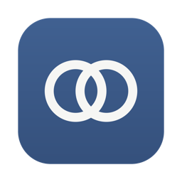
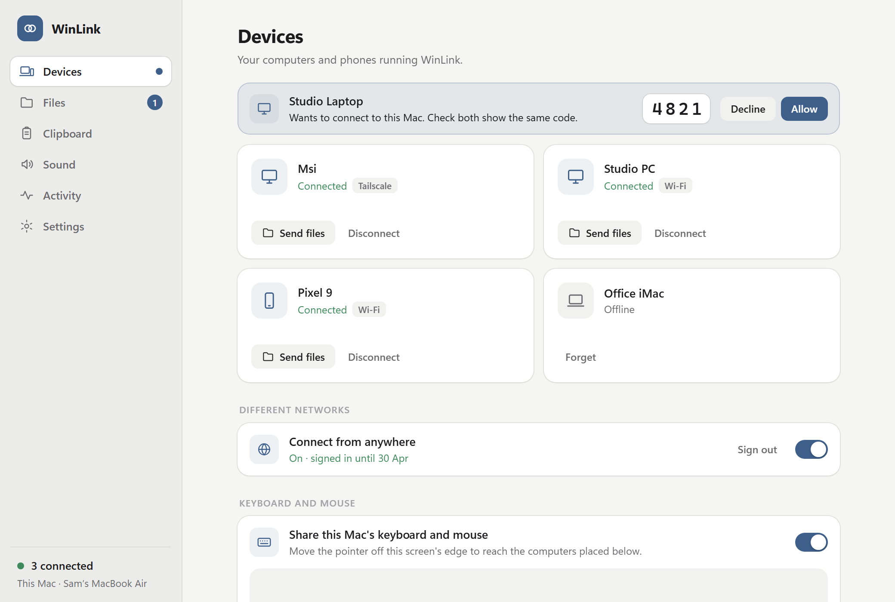
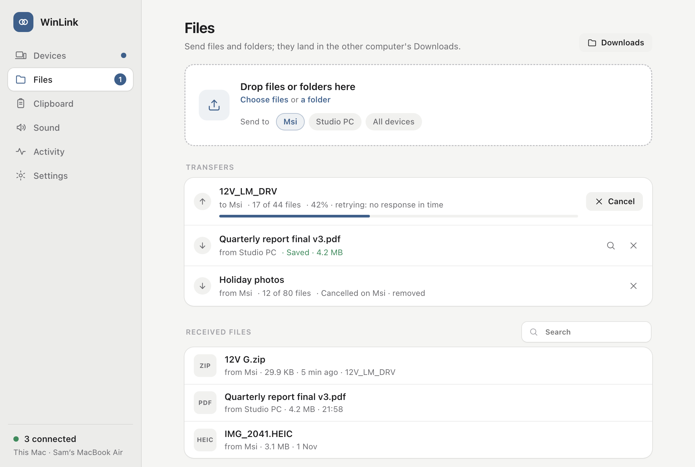
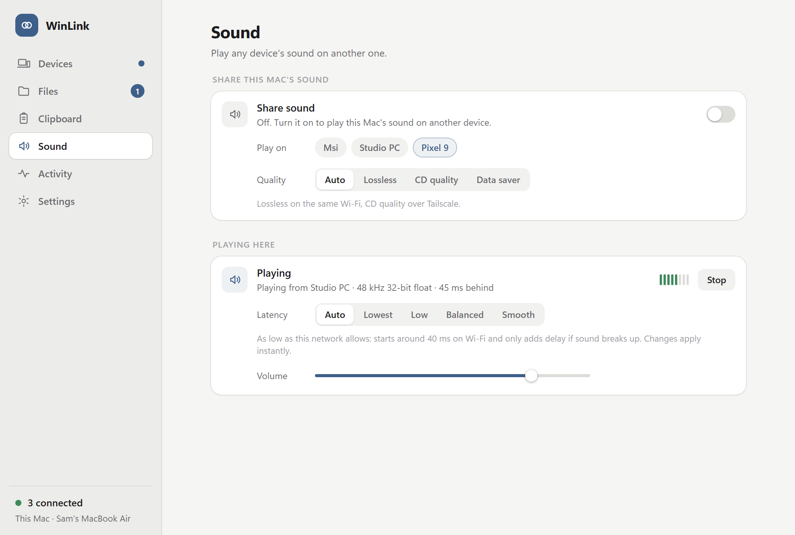
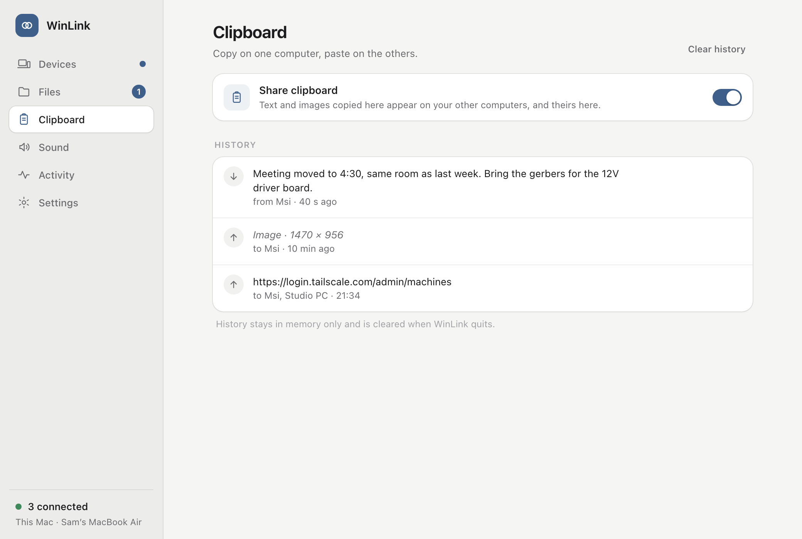
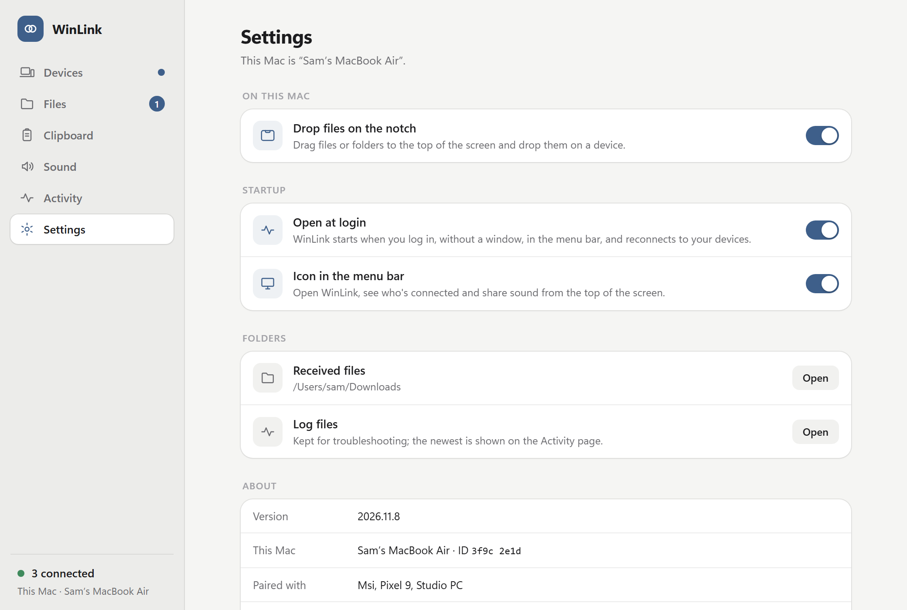
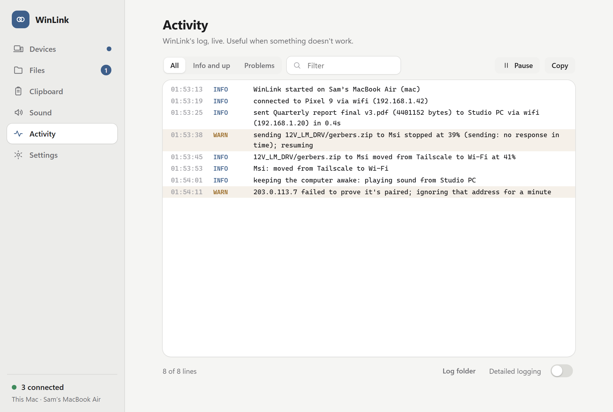
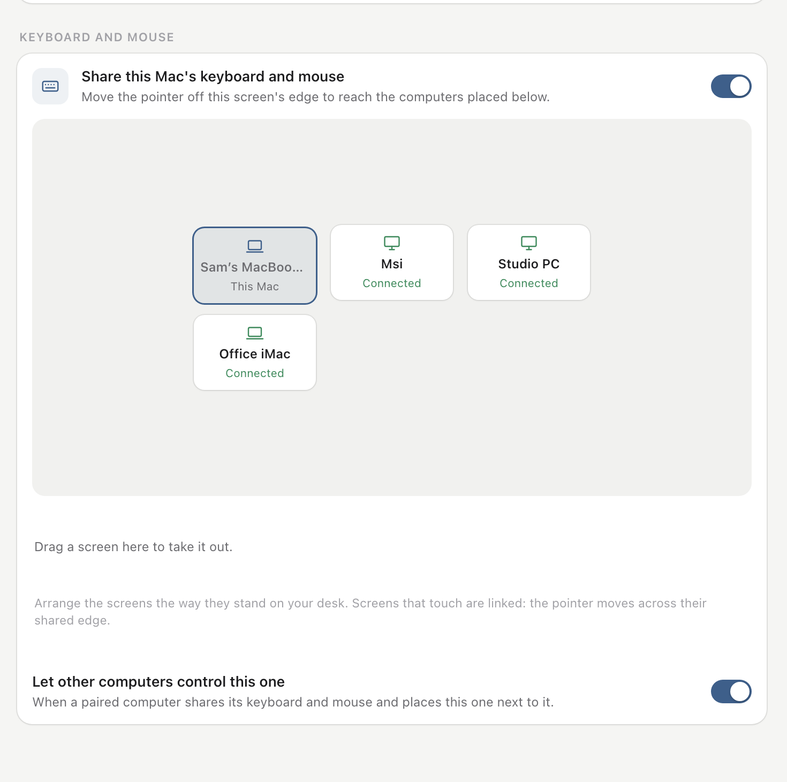

<p align="center">
  
</p>

<h1 align="center">WinLink</h1>

<p align="center">
  <b>Your Mac, Windows and Linux computers and your phone, working as one.</b><br>
  Shared clipboard · files and folders · sound from any device to any device · on the same Wi‑Fi or from anywhere
</p>

<p align="center">
  <a href="LICENSE"></a>
  
  
  
  
</p>

<p align="center">
  <picture>
    <source media="(prefers-color-scheme: dark)" srcset="docs/screenshots/devices-dark.png">
    
  </picture>
</p>

---

## Contents
- [What it does](#what-it-does)
- [Screenshots](#screenshots)
- [Download and install](#download-and-install)
- [Using WinLink](#using-winlink)
- [Security](#security)
- [How it works](#how-it-works)
- [Building from source](#building-from-source)
- [Project layout](#project-layout)
- [Roadmap](#roadmap)
- [License](#license)

## What it does

| | |
|---|---|
| **Clipboard** | Copy text or an image on one device, paste it on the others. A history of the last 50 items lets you copy any of them again. |
| **Files** | Drop files or whole folders on the window, the Mac's notch, Explorer's *Send to* menu or a Linux file manager. They land in the other device's Downloads. Transfers resume after drops, can be cancelled from either side, and move to Wi‑Fi mid-way when it becomes available. |
| **Sound** | Play any computer's sound on any other device, phones included: lossless on the same Wi‑Fi, about 20–50 ms behind. Android phones can share their sound too. |
| **Finds devices by itself** | No IP addresses. Bonjour and broadcast on the local network, including phone hotspots and IPv6-only networks. |
| **From anywhere** | Built-in Tailscale: switch on *Connect from anywhere*, sign in once, and your devices reach each other on any network, no Tailscale app needed. Back on the same Wi‑Fi, WinLink moves to the faster direct route without interrupting anything. |
| **Private** | Devices pair with a 4-digit code, every connection proves it's paired, and everything is encrypted, on Wi‑Fi too. |
| **Keyboard and mouse** | Use one computer's keyboard and mouse on the others: move the pointer off the edge of the screen. Built on [Deskflow](https://github.com/deskflow/deskflow), set up and secured by WinLink. |
| **Quiet** | Lives in the menu bar or tray, opens at login, keeps the computer awake only while sound plays or a transfer runs. |
| **Headless** | On Linux servers, `winlink daemon` plus a full command line: pair, send folders with progress, clipboard, sound, Tailscale sign-in. |

## Screenshots

<table>
  <tr>
    <td width="50%">
      <picture><source media="(prefers-color-scheme: dark)" srcset="docs/screenshots/files-dark.png"></picture>
      <p align="center"><b>Files</b>: transfers with progress, resume and cancel</p>
    </td>
    <td width="50%">
      <picture><source media="(prefers-color-scheme: dark)" srcset="docs/screenshots/sound-dark.png"></picture>
      <p align="center"><b>Sound</b>: share or play, with the real delay shown</p>
    </td>
  </tr>
  <tr>
    <td>
      <picture><source media="(prefers-color-scheme: dark)" srcset="docs/screenshots/clipboard-dark.png"></picture>
      <p align="center"><b>Clipboard</b>: shared automatically, with history</p>
    </td>
    <td>
      <picture><source media="(prefers-color-scheme: dark)" srcset="docs/screenshots/settings-dark.png"></picture>
      <p align="center"><b>Settings</b>: notch, open at login, menu bar or tray</p>
    </td>
  </tr>
  <tr>
    <td colspan="2">
      <picture><source media="(prefers-color-scheme: dark)" srcset="docs/screenshots/activity-dark.png"></picture>
      <p align="center"><b>Activity</b>: the live log, for when something doesn't work</p>
    </td>
  </tr>
</table>

Screenshots use sample data. The window looks the same on Windows and Linux.

## Download and install

Ready-made downloads are on the **[Releases](../../releases) page**.

| System | Download | Install |
|---|---|---|
| **macOS 13+** | `WinLink-mac-AppleSilicon.dmg` (M1 and newer) or `WinLink-mac-Intel.dmg` | Open it and drag **WinLink** to Applications. It isn't notarised by Apple, so the first time right-click WinLink → **Open** (on macOS 15: System Settings → Privacy & Security → **Open Anyway**). |
| **Windows 10/11** | `WinLink-Setup.exe` | Run it; it installs for your user (no administrator needed). Works on Windows on ARM too. If Windows Firewall asks, allow **Private networks**. |
| **Ubuntu, Debian, Mint, Pop!_OS** | `winlink_…_amd64.deb` (`_arm64.deb` for ARM) | `sudo apt install ./winlink_*.deb` |
| **Fedora** | `winlink-….x86_64.rpm` (`.aarch64.rpm` for ARM) | `sudo dnf install ./winlink-*.rpm` |
| **Other Linux** (Arch, openSUSE…) | the source code | `sh install_linux.sh` (see [Linux](#linux)). |
| **Android 10+** | `WinLink.apk` | Open it on the phone and allow installing from your browser. |

### Mac
If macOS asks to let WinLink find devices on your local network, click **Allow**. To share the Mac's
sound, macOS asks once for **Screen & System Audio Recording**; WinLink shows a button that opens it.

### Windows
WinLink's window uses Microsoft Edge WebView2, which is built into Windows 10 and 11. Remove it from
Settings → Apps like any other app.

### Linux
📖 **[The full Linux guide and command reference](docs/linux.md)**: desktop and headless use, every
`winlink` command, scripting, systemd, firewall and troubleshooting.

The `.deb` and `.rpm` packages have everything in one: the window, headless mode (`winlink daemon`)
and the `winlink` command; your package manager installs what they need. On other distributions,
`install_linux.sh` (in the source code) installs the system packages WinLink needs, sets it up for your
user in `~/.local/share/winlink` and adds it to your apps menu. Works with GNOME, KDE, Cinnamon, Xfce
and others, on X11 or Wayland.

- `winlink --check` shows what works on your PC and what to install for anything that doesn't.
- **Clipboard:** wl-clipboard on Wayland desktops that allow it (KDE, Sway, Hyprland); X11 (xclip)
  everywhere else, including GNOME on Wayland.
- **Sharing sound:** captures what the PC plays through PulseAudio or PipeWire (`parec`).
- **Firewall:** if devices can't connect, allow TCP 50555, UDP 50556 and mDNS (UDP 5353). The installer
  offers to do this for ufw and firewalld.
- Update: install the new package the same way. Remove: `sudo apt remove winlink` / `sudo dnf remove winlink`
  (with `install_linux.sh`: `sh install_linux.sh --uninstall`).

### Phones
The phone app is in [`mobile/`](mobile) (React Native with Expo). Android: install the APK. iPhone: build
it from source for now (see [Building from source](#building-from-source)).

## Using WinLink

### First connection
Open WinLink on both devices and click **Connect** on one. The other shows *Wants to connect* with a
4-digit code. Check that both show the same code, then click **Allow**. After that they reconnect by
themselves whenever both are on.

The code comes from a key exchange between the two devices: if someone on the network tried to sit in
the middle, the codes wouldn't match, so if they differ, click **Decline**. Pair each pair of devices
once; with several, clipboard goes to all of them and *Send to* / *Play on* let you pick one or all.

### Files
- **Window:** drop files or folders on WinLink, or use *Choose files*.
- **Notch (Mac):** turn on *Drop files on the notch*; drag to the top of the screen and drop on a device.
- **Send to (Windows):** right-click → *Send to* → *WinLink - &lt;device&gt;* (Windows 11: *Show more options*).
- **Linux file managers:** Files (*Scripts → WinLink*), Dolphin (*Send with WinLink*), Nemo.
- **Phones:** *Share → WinLink* from any app. Received files go to *Downloads › WinLink*.

Each transfer is one row with **Cancel** on both sides; cancelling removes everything that already
arrived. Dropped connections resume where they stopped. Optional **auto-clean** moves received files
to the Trash after a number of days (only files WinLink saved, and never ones you edited or moved).

### Clipboard
Text and images copied on one device appear on the others. Files copied in Finder or Explorer aren't
shared through the clipboard (drop them on WinLink instead). On Android, sending the phone's clipboard is
one tap: the *Send clipboard* button, the Quick Settings tile or the notification button.

### Sound
Any computer (and Android) can share its sound: **Sound → Share sound**, then choose where it plays. The
device playing it shows **Stop**, which also stops the sender. A device sharing its own sound won't play
someone else's, so sound can't loop between them.

- **Latency** (on the device that plays): **Auto** starts around 40 ms on Wi‑Fi and only adds delay if
  sound breaks up; **Lowest** about 20 ms, **Low** 50, **Balanced** 120, **Smooth** 300. The window shows
  how far behind playback really is.
- **Quality** (on the device that shares): Auto (lossless on Wi‑Fi, CD quality over Tailscale), Lossless,
  CD quality, or Data saver for weak links.

### Keyboard and mouse
Use one computer's keyboard and mouse on your other computers, like one big desk: move the pointer off
the edge of the screen and keep typing on the next one.

1. On Mac and Windows there's nothing to install: WinLink has Deskflow's engine built in. On Linux,
   install **[Deskflow](https://github.com/deskflow/deskflow/releases/latest)** 1.27 or newer (your
   distribution's package, or the one for it on Deskflow's releases page); WinLink finds it by itself.
2. On the computer whose keyboard and mouse you want to use: Devices → **Keyboard and mouse** → turn on
   **Share this computer's keyboard and mouse**.
3. **Arrange the screens** the way they stand on your desk: drag your other computers from the tray
   onto the arrangement, next to this screen or next to each other (a row of three, one above
   another…). Screens that touch are linked, so the pointer moves across their shared edge. A screen
   that doesn't touch any other is outlined in red; drag one back to the tray to take it out.

<p align="center"><picture><source media="(prefers-color-scheme: dark)" srcset="docs/screenshots/keyboard-mouse-dark.png"></picture></p>

WinLink writes Deskflow's configuration, gives each computer a TLS certificate and exchanges
fingerprints over its own encrypted link, so Deskflow only accepts your paired computers and never
asks you to compare fingerprints. Deskflow's clipboard sharing stays off (WinLink shares the clipboard,
with images and history). Its files live in WinLink's settings folder, so a Deskflow you set up yourself
isn't touched.

- On a **Mac**, allow WinLink under *Privacy & Security → Accessibility* (WinLink shows a button).
- The other computers follow automatically; turn off *Let other computers control this one* to refuse.
- It works wherever WinLink connects: same Wi-Fi, the Tailscale app, WinLink's built-in Tailscale, and
  networks that only let one computer reach the other. Deskflow's connection travels over WinLink's
  encrypted link (Deskflow's own TLS still runs inside it). Away from the same network, the pointer lags
  by the round trip between the computers.

### Connect from anywhere
1. Switch on **Connect from anywhere** on each device (Devices page; on Android, *Away from home*).
2. Click **Sign in** and sign in to Tailscale in the browser (a free account works), with the **same
   account everywhere**. Once per device.
3. Devices show *Connected · Tailscale* whenever they're online, on any network.

The sign-in is stored encrypted (Mac Keychain, Windows DPAPI, Linux keyring, Android keystore). Tailscale
expires sign-ins after 180 days by default; WinLink warns two weeks ahead, or turn off key expiry for the
*winlink-…* devices in Tailscale's admin page. If you already use the Tailscale app, WinLink finds your
devices through it too.

### Open at login, tray and menu bar
Settings → Startup: **Open at login** starts WinLink without a window. Its icon lives in the **menu bar**
(Mac) or **tray** (Windows notification area, Linux panel) and shows who's connected, with sound sharing
and *Connect from anywhere* switches. Minimising hides WinLink completely (no Dock or taskbar entry);
the icon brings it back. GNOME shows tray icons only with the *AppIndicator* extension (Ubuntu has it).

Hidden, WinLink isn't slowed down by App Nap or Windows' efficiency mode, and while sound plays or a
transfer runs the computer doesn't fall asleep (the screen still turns off); afterwards it sleeps normally.

### Linux without a desktop
See **[docs/linux.md](docs/linux.md)** for every command with examples. In short: `winlink daemon` runs WinLink without a window; `winlink service install` keeps it running at every boot
(systemd user service; on a server also run `sudo loginctl enable-linger $USER`).

```text
winlink status                       this computer, devices, transfers, Tailscale
winlink add 192.168.1.20             find a device by address (other subnets, VPNs)
winlink pair laptop                  pair: compare the code shown, press Allow on the laptop
winlink accept "Sam's Mac"           allow a device that asked to pair
winlink send laptop ~/reports        send files or folders, with progress (--no-wait: in the background)
winlink send all photo.jpg           ...to every connected device
winlink transfers / cancel <id>
winlink clip "some text"             put text on your devices' clipboards (or: cmd | winlink clip -)
winlink clip                         print the last text copied on another device
winlink sound share laptop | sound stop
winlink login / logout               Connect from anywhere: prints a sign-in link to open on any device
winlink show | hide | quit | log -f | help
```

Devices can be named by the start of their name (`lap` for *Laptop*).

## Security
- **Paired devices only.** Pairing is an X25519 key exchange confirmed by a 4-digit code. Every
  connection then proves it holds the pairing key (HMAC) before anything happens.
- **Encrypted everywhere.** Clipboard, files and sound use ChaCha20-Poly1305 with fresh keys per
  connection, on Wi‑Fi too. Tampered data is rejected.
- **Flood protection.** Limits on connections per address, attempts per second and pairing prompts; an
  address that fails to prove itself five times is ignored for five minutes.
- **Keys stay put.** Pairing keys and the Tailscale sign-in are stored with the system's own protection
  (Keychain, DPAPI, keyring, Android keystore).
- **Logs** for troubleshooting are in WinLink's settings folder: `~/Library/Application Support/WinLink`
  (Mac), `%APPDATA%\WinLink` (Windows), `~/.config/WinLink` (Linux).

## How it works

```text
┌───────── Mac · Windows · Linux ──────────┐               ┌───────── Android ──────────┐
│ window (pywebview, src/webui) · tray     │               │ React Native UI (Expo)     │
│ app.py, net.py: discovery, pairing,      │   TCP 50555   │ node.ts: the same protocol │
│   control link, files, clipboard         │◄─────────────►│   in TypeScript            │
│ audio.py: capture (WASAPI, Screen-       │  encrypted    │ Kotlin: player, capture,   │
│   CaptureKit, PipeWire), adaptive player │               │   background service       │
│ linkts (Go, tsnet): built-in Tailscale   │◄── tailnet ──►│ linkts for Android         │
└──────────────────────────────────────────┘               └────────────────────────────┘
```

- **Discovery:** UDP broadcast/multicast beacons (port 50556) and Bonjour (`_winlink._tcp`).
- **Connections:** one long-lived, encrypted *control* link per pair of devices (clipboard, pings, cancel,
  hand-over info), plus one connection per file and per sound stream. Every connection is authenticated
  and encrypted (`secure.py`, `secure.ts`).
- **Routes:** devices race their local addresses first and fall back to Tailscale. When a device shows up
  on the local network again, the link, running transfers and sound streams move over to it.
- **Built-in Tailscale:** `helper/` is a small Go program built on Tailscale's
  [tsnet](https://tailscale.com/kb/1244/tsnet). It joins your tailnet as its own device and forwards
  connections over a private localhost port, so no VPN or Tailscale app is needed.
- **Sound:** 10–20 ms chunks, an adaptive jitter buffer that holds its target delay (clock drift and
  Wi‑Fi bursts are trimmed inaudibly), and dropouts that raise the delay only when needed.

## Building from source

**Desktop** (Python 3.11+; Go 1.23+ for the Tailscale helper):

```sh
sh helper/build_all.sh          # Tailscale helper for every system, into bin/
sh build_mac.sh                 # Mac: WinLink.app (set WINLINK_SIGN_IDENTITY to sign with your identity)
build_windows.bat               # Windows: dist\WinLink\WinLink.exe
sh install_linux.sh             # Linux: installs for your user
```

The downloads on the Releases page are built by [`.github/workflows/release.yml`](.github/workflows/release.yml)
on GitHub's machines: it compiles Deskflow's engine from its source for Mac and Windows, builds WinLink
for every system and packages it ([`packaging/`](packaging): the Windows installer, the Mac disk image,
the Linux packages). Push a tag `v<version>` (matching `VERSION` in `src/net.py`) to make a draft release.

Run from source on a Mac without building:
`python3 -m venv .venv && .venv/bin/pip install -r requirements-mac.txt && .venv/bin/python src/link.py`

**Phone** (Node 20+, an [Expo](https://expo.dev) account for cloud builds):

```sh
cd mobile
npm install
sh ../helper/build_android.sh   # the Tailscale helper for Android
npx eas build -p android --profile preview      # a standalone APK
npx eas build -p android --profile development  # a development build, then: npx expo start --dev-client
```

**Tests** (they run the phone's TypeScript against the real desktop code, on private ports):

```sh
cd mobile
npm run test:protocol   # pairing, clipboard, files and sound both ways
npm run test:faults     # cut and silent connections during every kind of transfer
npm run test:switch     # moving from Tailscale to Wi-Fi mid-transfer and mid-song
npm run test:tailnet    # the built-in Tailscale helper
python3 tests/harness/desktop_kvm.py "$(mktemp -d)"   # keyboard and mouse, with Deskflow installed
```

## Project layout

```text
src/            the desktop app (Python): app.py window and state, net.py networking, audio.py sound,
                secure.py encryption, cli.py + commands.py command line, kvm.py keyboard and mouse
                (Deskflow), tray.py, autostart.py, keepawake.py,
                clip_*.py clipboards, notch_mac.py, webui/ the window's HTML
helper/         the built-in Tailscale helper (Go, tsnet) and its build scripts
packaging/      the Windows installer (Inno Setup), the Mac disk image, the Linux packages (nfpm)
mobile/         the phone app (Expo): src/core protocol, modules/winlink-native Kotlin and Swift, tests/
assets/         icons
docs/           screenshots
```

## Roadmap
- Automatic phone → computer clipboard on Android (text-selection menu, send on open, optional automatic mode).
- iPhone release build.

## License
WinLink is free software under the [GNU General Public License v3.0](LICENSE).

Keyboard and mouse sharing runs [Deskflow](https://github.com/deskflow/deskflow) (GPL-2.0) as its own
program; the Mac and Windows downloads include its engine, built from Deskflow's unmodified source (its
licence and a link to that source are next to it). It builds on [Tailscale](https://github.com/tailscale/tailscale) (BSD-3-Clause),
[pywebview](https://github.com/r0x0r/pywebview), [Expo](https://expo.dev) and
[React Native](https://reactnative.dev), [python-zeroconf](https://github.com/python-zeroconf/python-zeroconf),
[sounddevice](https://github.com/spatialaudio/python-sounddevice),
[cryptography](https://github.com/pyca/cryptography) and the
[noble](https://paulmillr.com/noble/) libraries.
